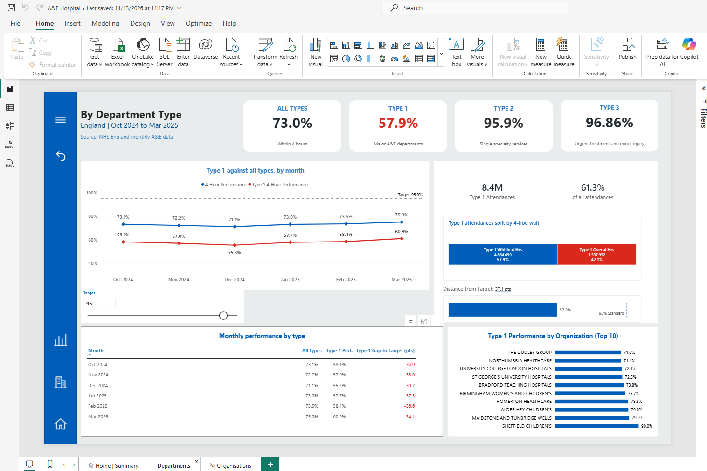
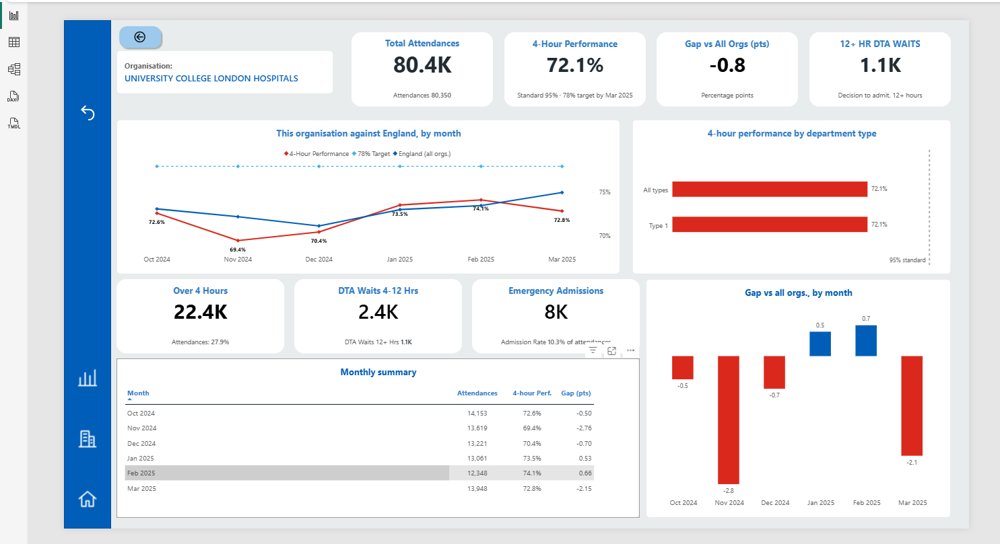
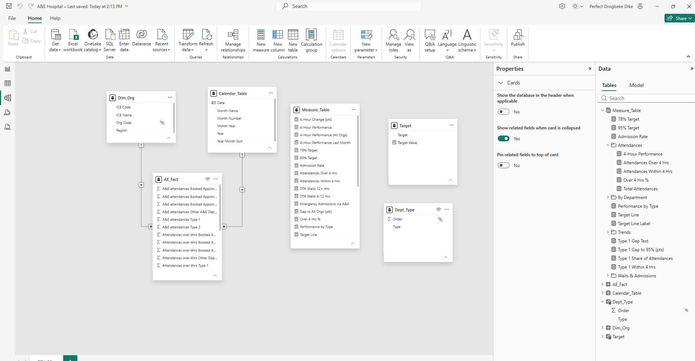
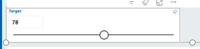
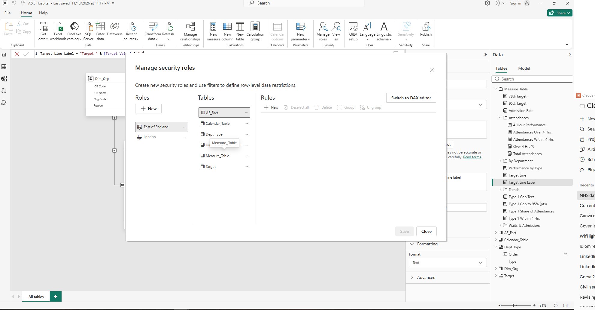
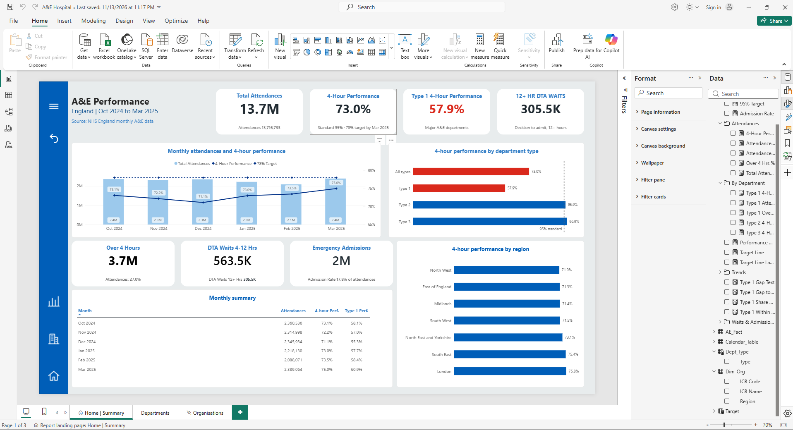
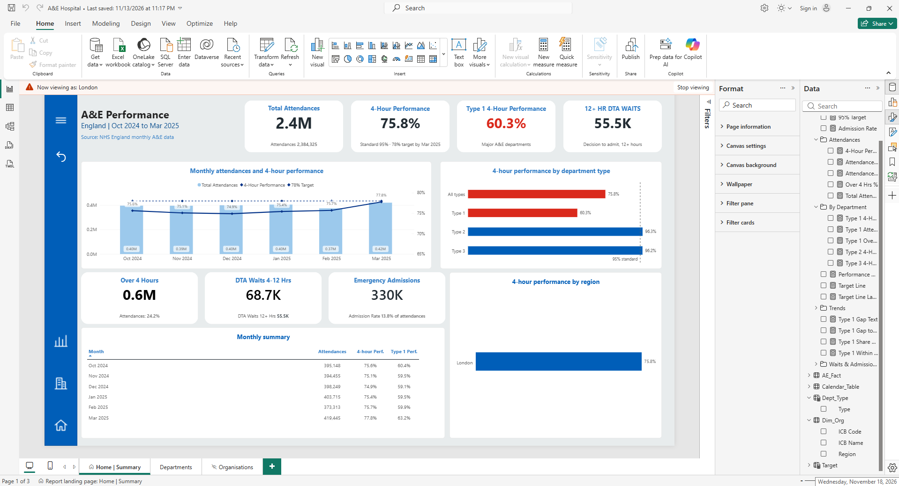

# A-E-Performance-PowerBI-Dashboard
An end-to-end Power BI project that turns six monthly NHS England A&amp;E files into an interactive, three-page dashboard. It shows how well A&amp;E departments in England met the 4-hour standard between October 2024 and March 2025, by department type, region, ICB and individual organisation.
<!-- IMAGE: full screenshot of Page 1 (Summary), no filters applied. Save as images/page1_summary.png -->


<!-- IMAGE: full screenshot of Page 2 (By department type), target slider at 95. Save as images/page2_departments.png -->


<!-- IMAGE: full screenshot of Page 3 (Organisation detail) opened by drill-through from one organisation. Save as images/page3_organisation.png -->


## The question

**How far did A&E performance fall short of the 4-hour standard over winter 2024-25, which types of department and which organisations drove the shortfall, and how did it change month by month?**

## The data

- **Source:** [NHS England, A&E Attendances and Emergency Admissions 2024-25](https://www.england.nhs.uk/statistics/statistical-work-areas/ae-waiting-times-and-activity/ae-attendances-and-emergency-admissions-2024-25/): the monthly CSV files for October 2024 to March 2025. Published by NHS England and reused here with attribution; see the source page for the publisher's reuse terms.
- **What a row means:** one organisation (NHS trust or other A&E provider) in one month, with 22 columns. They hold attendances, attendances over 4 hours, patients waiting 4 to 12 hours and 12+ hours from decision to admit, and emergency admissions, split by department type.
- **Department types:**
  - **Type 1:** major, consultant-led 24-hour A&E departments.
  - **Type 2:** single-specialty services, such as eye or dental.
  - **Type 3:** urgent treatment centres, walk-in and minor injury units.

  They are shown separately because they behave very differently, and combining them hides the pressure on major A&Es.
- **Booked appointments** are included in the totals, as in NHS England's published figures.
- **Size:** 198 organisations in February, of which 121 have Type 1 activity. The rest are walk-in centres, community providers and similar.

## What I did, step by step

**1. Profiled and reconciled the data.** I checked that all six files share the same 22 column names, then found the `TOTAL` row in each file. It holds national totals and would double every sum, so it is removed. I reconciled the February CSV against NHS England's published England row. Total attendances (2,088,071), attendances over 4 hours (554,146) and all-types performance (73.5%) matched exactly, and so did Type 1 (58.4%), Type 2 (95.9%) and Type 3 (97.0%).

**2. Checked the data-quality notice.** NHS England corrected some provider-level figures that were revised on 15 May 2025. I compared the February CSV with the corrected spreadsheet for all 198 providers on every affected column and found no differences. The November correction affects a published percentage column that this project does not use, because performance is calculated from the raw counts.

**3. Cleaned and combined in Power Query.**
- Combined the monthly files from a folder, so a new month is added by dropping the file in the folder and refreshing.
- Removed the `TOTAL` rows, trimmed spaces in `Parent Org` (the NHS England region), and derived the reporting month from the `Period` text (for example `MSitAE-FEBRUARY-2025`).
- Built a proper `Calendar_Table` and marked it as the date table.

**4. Linked organisations to ICBs and regions.** The CSV has no ICB column, so I used NHS England's *System Mapping* sheet as `Dim_Org` (Org Code, ICB Code, ICB Name, Region). It had two duplicate codes, which I removed first. All organisations matched except one (NTV0B, Ashford Walk-in Centre), which appears as Blank in region and ICB charts and is filtered out of them. This is a snapshot mapping, so it reflects ICB boundaries at the time of the sheet, not each month.

**5. Built a star-schema data model.**

| Table | Role |
|---|---|
| `AE_Fact` | Monthly attendances, breaches, waits and admissions by organisation |
| `Dim_Org` | Organisation, ICB and region |
| `Calendar_Table` | Date table for time intelligence |
| `Dept_Type` | Disconnected table that drives a Type 1, 2, 3 or All switch |
| `Target` | What-if parameter for the performance target |
| `Measure_Table` | All DAX measures in one place |

<!-- IMAGE: screenshot of Model view showing all tables and relationships. Save as images/data_model.png -->


**6. Wrote the DAX measures.** The definitions are:
- **Total attendances** = all six attendance columns (three department types plus three booked-appointment columns).
- **Within 4 hours** = total attendances minus attendances over 4 hours, because the CSV has no "within" column.
- **4-hour performance** = within 4 hours ÷ total attendances. The Type 1, 2 and 3 versions use only that type's columns (Type 1 includes booked Type 1).

Some of the other measures:

```DAX
Type 1 Within 4 Hrs = [Type 1 Attendances] - [Type 1 Over 4 Hrs]

Type 1 Share of Attendances = DIVIDE ( [Type 1 Attendances], [Total Attendances] )

Gap vs All Orgs (pts) =
IF (
    ISBLANK ( [4-Hour Performance] ),
    BLANK (),
    ( [4-Hour Performance] - [4-Hour Performance (All Orgs)] ) * 100
)

Performance by Type =
SWITCH (
    SELECTEDVALUE ( Dept_Type[Type] ),
    "All types", [4-Hour Performance],
    "Type 1", [Type 1 4-Hour Performance],
    "Type 2", [Type 2 4-Hour Performance],
    "Type 3", [Type 3 4-Hour Performance]
)

Selected Org Name = SELECTEDVALUE ( AE_Fact[Org name], "All organisations" )

95% Target = [Target Value] / 100
```

Other measures cover dynamic titles and subtitles, text labels that combine a number and a unit, and a gap measure that returns blank, not zero, for organisations with no activity, so empty rows are not shown as false underperformance.

**7. Designed the report.** An NHS-inspired light theme (NHS blue `#005EB8`, dark blue `#003087`, red `#DA291C` for shortfalls), Segoe UI, white cards on a pale grey background, and a left navigation rail with icon buttons.

**8. Added interactivity.**
- **Page 1, Summary:** KPI cards, a combo chart of attendances against 4-hour performance by month, performance by department type, a monthly table and performance by region.
- **Page 2, By department type:** a line chart of Type 1 against all types with a target line, a Type 1 within-and-over-4-hours split bar, and a "distance from target" bar.
- **Page 3, Organisation detail:** a drill-through page opened from any organisation. It compares that organisation with England by month, by department type and by gap to the all-organisation average.
- **Filter panel:** a hamburger button opens a slicer panel (month, region, department type) using bookmarks. The bookmarks update Display only, so closing the panel does not clear the filters.
- **Sync slicers** carry the month and region selections across pages.
- **Reset button:** a bookmark that returns the report to its built state.
- **Edit interactions:** cards that should always show the six-month position are set to ignore slicers, and charts that should filter, not highlight, are set to Filter.
- **Target slider:** a what-if parameter (see below).

## The target slider

<!-- IMAGE: Page 2 with the slider moved to 78 so the target line and gap figures have moved. Save as images/target_slider_78.png -->


The 4-hour standard is **95%**, but NHS England set an interim goal of **78% by March 2025**, so a single fixed 95% line makes every organisation look equally far away. A what-if parameter (`Target`, 50 to 100, default 95) lets the reader choose the target. It drives the `95% Target` measure, which feeds the target line, the gap figures, the distance bar and the table.

It **never changes actual performance figures**, only the gap to the selected target. The default is the official 95% standard.

## Key findings

| | Six-month total |
|---|---|
| Total attendances | 13,716,733 |
| Attended within 4 hours | 10,009,282 |
| Attended over 4 hours | 3,707,451 (27.0%) |
| **4-hour performance, all types** | **73.0%** |
| Type 1 (major A&E) performance | 57.9% |
| Type 2 performance | 95.9% |
| Type 3 performance | 96.9% |

| Month | Attendances | All types | Type 1 |
|---|---|---|---|
| Oct 2024 | 2,360,536 | 73.1% | 58.1% |
| Nov 2024 | 2,314,998 | 72.2% | 57.0% |
| Dec 2024 | 2,345,934 | 71.1% | 55.3% |
| Jan 2025 | 2,218,130 | 73.0% | 57.7% |
| Feb 2025 | 2,088,071 | 73.5% | 58.4% |
| Mar 2025 | 2,389,064 | 75.0% | 60.9% |

- **The standard was never met.** All-types performance stayed between about 71% and 75% in every month, well below 95% and, until March, below the 78% interim goal.
- **The shortfall is a Type 1 problem.** Type 2 (95.9%) and Type 3 (96.9%) are both above 95%. Type 1 is 37.1 percentage points below the standard, and it carries 61.3% of all attendances (8.4 million). Of those, 3.54 million (42.1%) waited more than 4 hours.
- **December was the low point, March the high.** Type 1 fell to 55.3% in December and recovered to 60.9% in March. All-types performance gained 3.9 points between December and March.
- **February looks lower on volume but only because it is a short month** (28 days).
- **Long waits.** 305,532 patients waited 12 hours or more from a decision to admit to being admitted, and a further 563,503 waited between 4 and 12 hours.
- **Admissions.** 2,437,319 attendances led to an emergency admission, 17.8% of all attendances.
- **Regions.** Six-month performance ranges from about 71.0% in the North West to 75.8% in London.

## Row-level security

<!-- IMAGE: screenshot of the Manage security roles window showing the London and East of England roles and their Region filters. Save as images/rls_roles.png -->


<!-- IMAGE: Page 1 with no role applied, showing England-wide total attendances. Save as images/rls_no_role.png -->


<!-- IMAGE: Page 1 using Modeling > View as > London, with the role banner visible and total attendances lower than England. Save as images/rls_london.png -->



Two example roles (London and East of England) filter `Dim_Org[Region]`, so a regional lead would see only their own organisations across every page, including drill-through. I tested for London with **View as** in Power BI Desktop. In production the roles would be assigned to groups in the Power BI Service, or made dynamic with `USERPRINCIPALNAME()`.

Two things to know. RLS is enforced only in the Power BI Service, and only for Viewers. It does nothing in the .pbix file itself. And measures that compare against "all organisations" see only the role's organisations under a role, so the benchmark becomes that region's average, not England's.

## Design decisions and limitations

- **Six months only.** The period covers winter 2024-25, so it can't show a full-year or seasonal pattern.
- **Type 1 is the headline.** The all-types figure is shown for context, but it is flattered by Type 2 and Type 3 activity that meets the standard easily.
- **Snapshot ICB mapping.** ICB and region come from a single mapping sheet, not from each month.
- **One organisation is unmapped.** NTV0B (Ashford Walk-in Centre) has no ICB or region, so it is excluded from region and ICB charts and counted only in England totals.
- **Comparing across June 2023.** Fourteen trusts began testing new field-test measures from then, so care is needed comparing with older data. This project does not use older data.
- **Small organisations.** Percentages for organisations with few attendances swing widely and should be read alongside volume.
- **Colour bands** are my own illustrative thresholds, not official NHS targets, apart from the 95% standard and the 78% interim goal.

## Skills demonstrated

Power Query (folder combine, cleaning, reconciliation), star-schema modelling, DAX (SWITCH, SELECTEDVALUE, ALL, DATATABLE, text measures, what-if parameters), report design with a custom theme, drill-through, bookmarks, sync slicers, edit interactions, conditional formatting, row-level security, and written documentation of assumptions.

## Repository

```
├── AE_Performance.pbix
├── AE_NHS_Light_theme.json
├── images/          # screenshots used in this README
└── README.md
```

*Independent portfolio project using publicly available NHS England data. Not affiliated with or endorsed by the NHS.*
